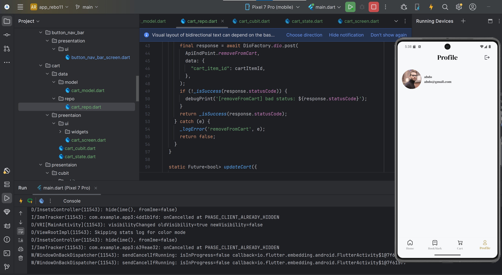
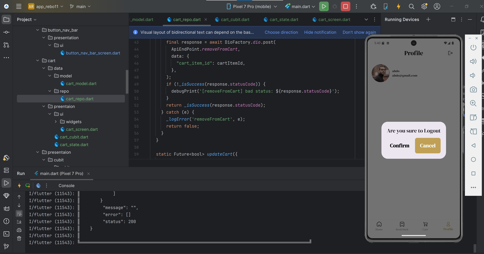
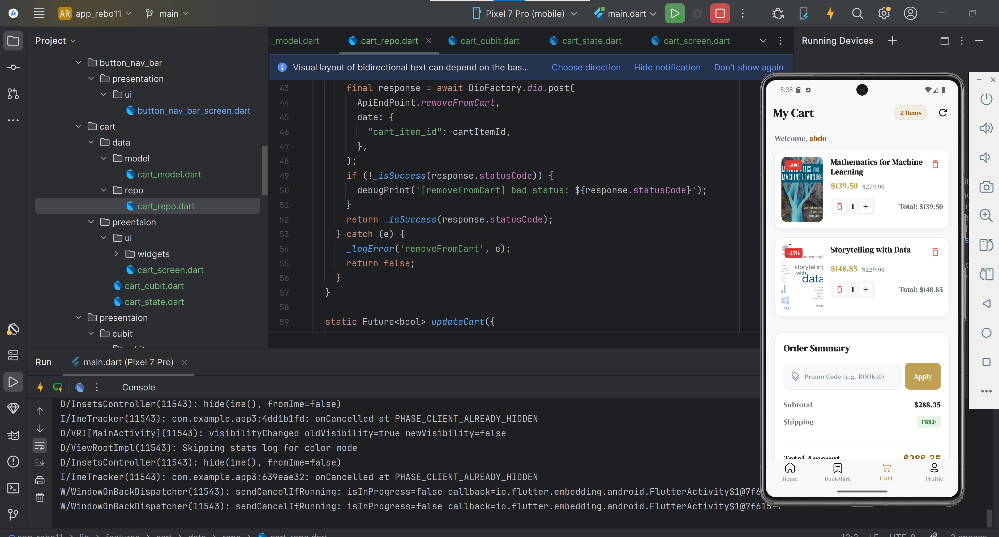
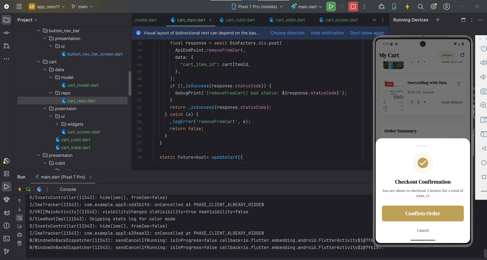

📚 Bookia App

A modern mobile application built with Flutter and Dart that lets users browse books, search, view details, manage a shopping cart, and manage their profile.

The project follows a modular, feature-based structure using Cubit (flutter_bloc) for state management and Dio for networking, so the code stays organized, reusable, and easy to maintain.

📱 Screenshots
Splash & Welcome

   

Authentication

    

Home

   

Search

   

Book Details

   

Bottom Navigation

   

Profile

   

Cart

   

Note: GitHub paths are case-sensitive, and filenames containing spaces (like welcome 2.png) must match exactly. Renaming files to use underscores (e.g. welcome_2.png) avoids problems.

✨ Features
Authentication
Login screen with email and password fields.
Registration screen UI.
Form validation for user input.
Loading, success, and error states managed by AuthCubit.
Navigation after successful authentication.
Home
Best Seller books list.
Banner slider with page indicators.
Add to cart directly from the home screen.
Search & Book Details
Search for books by name.
Book details screen (name, price, discount, description, category).
Navigation
Bottom navigation bar to move between the main screens.
Profile
Displays the logged-in user's data (name, email, image, address, city, phone).
Cart
Fetch the cart from the API with a skeleton loading effect.
Cart items list with image, name, price, discount, and quantity.
Increase / decrease quantity of an item.
Remove an item from the cart.
Order summary with the total price.
Item counter badge in the app bar.
Pull-to-refresh and a refresh button.
Empty cart view and error view.
Thin progress bar while an item is being updated or removed.
SnackBar error messages for failed operations.
Application Architecture
State management using Cubit and flutter_bloc.
Centralized API endpoints (ApiEndPoint).
Centralized named routes.
Repository pattern for data access.
Reusable UI components.
Responsive layouts using Flutter ScreenUtil.
Localization support using Easy Localization.
🛠️ Technologies & Packages
Package / Tool	Purpose
Flutter / Dart	Building the app and programming language
flutter_bloc	State management (Cubit and BlocBuilder / BlocConsumer / BlocProvider)
bloc	Core Bloc library used by flutter_bloc
meta	Annotations such as @immutable on state classes
dio	Sending HTTP requests (GET / POST) to the API
flutter_screenutil	Responsive sizing (.w, .h, .sp, .r)
easy_localization	Multi-language support (English / German)
pretty_dio_logger	Readable request/response logs in the console (verify in your pubspec.yaml)

Tip: Open pubspec.yaml and make sure this table matches the packages you actually use. Add any others you installed (for example image caching, shimmer, or HTML rendering packages).

🔐 Authentication
Login
Email and password input fields.
Form validation before submitting credentials.
API request using Dio.
Loading state while waiting for the response.
Success and error states managed by AuthCubit.
Navigation to the home screen after successful login.
The returned token is sent as a Bearer token in the Authorization header on later requests.
Register

Fields: Username, Email, Password, Confirm Password.

Note: The registration UI is separate from login and may not be connected to a working API endpoint yet.

Auth states: AuthInitial, LoginLoadingState, LoginSuccessState, LoginErrorState.

🏠 Home: Best Sellers & Slider
Best Seller
Endpoint: GET products-bestseller
HomeCubit.getBestSellerBox() emits loading, then success or error.
HomeRepo fetches the data and BookModel represents each book.
State	Purpose
HomeInitial	Before any request
GetBestSellerLoading	Books are loading
GetBestSellerSuccess	Request succeeded
GetBestSellerError	Request failed
Slider
Endpoint: GET sliders (response: data.sliders[].image).
File	Responsibility
slider_model.dart	Converts JSON to SliderModel, SliderData, SliderItem
slider_repo.dart	Sends the request using Dio
slider_cubit.dart	Calls the repo and emits states
slider_state.dart	SliderInitial, SliderLoading, SliderSuccess, SliderError
home_slider.dart	PageView.builder with indicators and Image.network

Both HomeCubit and SliderCubit are provided to the Home screen with MultiBlocProvider, so each request stays independent.

🔎 Search & Book Details
Search: products-search endpoint returns books matching the query.
Details: products/ endpoint combined with the book id returns the full book information (name, description, price, discount, price after discount, stock, category, image).
👤 Profile
Endpoint: GET profile/
Returns the user's id, name, email, address, city, phone, email verification status, and image.
🛒 Cart Feature
Endpoints
Action	Method	Endpoint	Body
Get cart	GET	cart/	none
Add to cart	POST	add-to-cart	product_id
Update quantity	POST	update-cart	cart_item_id, quantity
Remove item	POST	remove-from-cart	cart_item_id

cart_item_id is the id of the cart item (item_id in the cart response), not the product id. product_id is only used when adding to the cart.

Files
File	Responsibility
cart_model.dart	CartResponseModel, CartDataModel, cart items, user
cart_repo.dart	getCartData, removeFromCart, updateCart using Dio
cart_cubit.dart	Cart logic and currentCartData cache
cart_state.dart	Cart states
cart_screen.dart	Main cart screen (BlocConsumer)
cart_item_card.dart	Single item card with quantity and remove buttons
cart_summary.dart	Order summary and checkout
cart_skeleton_loading.dart	Loading placeholder
cart_empty_view.dart	Empty cart view
cart_error_view.dart	Error view
Cart States
State	Purpose
CartInitial	Before the cart is requested
GetCartLoading	Cart is loading
GetCartSuccess	Cart loaded (holds cartData)
GetCartError	Failed to load the cart
CartItemActionLoading	An item is being updated or removed
CartItemActionError	An item action failed (SnackBar shown in CartScreen)
Cart Flow
CartScreen calls getCartData() once when opened (if the state is CartInitial).
The cubit emits GetCartLoading, then GetCartSuccess with the data.
When the user changes quantity or removes an item, the cubit emits CartItemActionLoading and the screen shows a thin progress bar.
CartRepo sends the POST request. On success, the cart is fetched again so the UI shows the updated data.
On failure, an error state is emitted and a SnackBar message is shown.
Error Logging in CartRepo

CartRepo prints the status code, error type, and URL of any failed request using debugPrint, so failed requests are no longer silent:

text
[updateCart] DioException | status: 422 | type: DioExceptionType.badResponse | url: .../api/update-cart
🌐 API Integration

All endpoints are stored in one place:

dart
class ApiEndPoint {
static const String baseUrl = "https://codingarabic.eraapro.com/api/";

static const String login = "login";
static const String bestSeller = "products-bestseller";
static const String search = "products-search";
static const String BookDetails = "products/";
static const String sliders = "sliders";
static const String Profile = "profile/";

static const String AddToCart = "add-to-cart";
static const String cart = "cart/";
static const String removeFromCart = "remove-from-cart";
static const String updateCart = "update-cart";
}
Layer	Responsibility
ApiEndPoint	Base URL and endpoint paths
Repository	Sends requests and returns models
Model	Converts JSON into Dart objects
Cubit	Emits loading / success / error states
UI	Displays content based on the current state

Security: Never commit real tokens or passwords to GitHub, and remove the Authorization header value from any logs you share.

🧯 Troubleshooting & Lessons Learned

Problems solved while building the cart, kept here for future reference:

Status	Symptom	Cause	Fix
301 Moved Permanently	Remove item did nothing	POST endpoint ended with / (remove-from-cart/) and the server redirected it	Removed the trailing / from POST endpoints
404 Not Found	Add to cart did nothing	Wrong endpoint name (add_to_cart)	Changed to add-to-cart to match the API naming style
422 Unprocessable Entity	Quantity did not change	Server expects the field quantity, the app sent change_quantity	Renamed the body field to quantity
Silent failures	No error shown to the user	catch returned false without logging	Added debugPrint logging and a CartItemActionError state with a SnackBar

Takeaways

Read the Dio logs first: the status code usually tells you where the problem is.
Match field names and endpoint paths exactly with the API.
Do not swallow exceptions silently in repositories.
🧭 Navigation

Centralized named routing through AppRouter:

Login, Register, Welcome, Home
Bottom navigation between Home, Cart, and Profile (and other tabs if configured)

BlocProvider / MultiBlocProvider provide cubits to the screens that need them.

🎨 Reusable Components
AppButton: customizable button.
CustomTextFromFeild: reusable text field.
AppTextStyle: centralized text styles.
AppColors: centralized colors.
AppValidator: input validation helpers.
🌍 Supported Languages

Using Easy Localization:

🇬🇧 English
🇩🇪 German
📂 Project Structure

Illustrative. Update it to match the files that actually exist in your project.

text
app3/
├── assets/
│   ├── images/
│   └── translations/
│
├── lib/
│   ├── core/
│   │   ├── networking/
│   │   │   ├── api_endpoint.dart
│   │   │   └── dio_factory.dart
│   │   ├── routes/
│   │   │   ├── app_route.dart
│   │   │   └── app_router.dart
│   │   ├── themes/
│   │   │   ├── app_colors.dart
│   │   │   └── APP_text_Style.dart
│   │   ├── utils/
│   │   │   └── app_validator.dart
│   │   └── widget/
│   │       ├── App_button.dart
│   │       └── custom_text_from_feild.dart
│   │
│   ├── features/
│   │   ├── auth/
│   │   ├── home/
│   │   ├── cart/
│   │   │   ├── data/
│   │   │   │   ├── model/cart_model.dart
│   │   │   │   └── repo/cart_repo.dart
│   │   │   └── preentaion/
│   │   │       ├── cart_cubit.dart
│   │   │       ├── cart_state.dart
│   │   │       └── ui/
│   │   │           ├── cart_screen.dart
│   │   │           └── widgets/
│   │   │               ├── cart_empty_view.dart
│   │   │               ├── cart_error_view.dart
│   │   │               ├── cart_item_card.dart
│   │   │               ├── cart_skeleton_loading.dart
│   │   │               └── cart_summary.dart
│   │   └── welcome/
│   │
│   ├── bookia_App.dart
│   └── main.dart
│
├── README.md
└── pubspec.yaml
🚀 Getting Started
Prerequisites
Flutter SDK
Dart SDK
Android Studio or Visual Studio Code
An Android emulator or a physical device
Installation
bash
git clone YOUR_REPOSITORY_URL
cd app3
flutter pub get
flutter devices
flutter run

After changing const values such as endpoints, use Hot Restart (not Hot Reload).

🎯 Project Goals
Build a clean and responsive Flutter application.
Practice reusable widget development and form validation.
Integrate REST APIs using Dio (GET and POST).
Represent API responses using data models.
Separate data fetching into repository classes.
Manage auth, home, slider, and cart states with Cubit.
Organize navigation using named routes.
Debug API problems using HTTP status codes and logs.
👨‍💻 Author

Developed as a Flutter learning project to practice mobile application development, API integration, state management, and clean code organization.